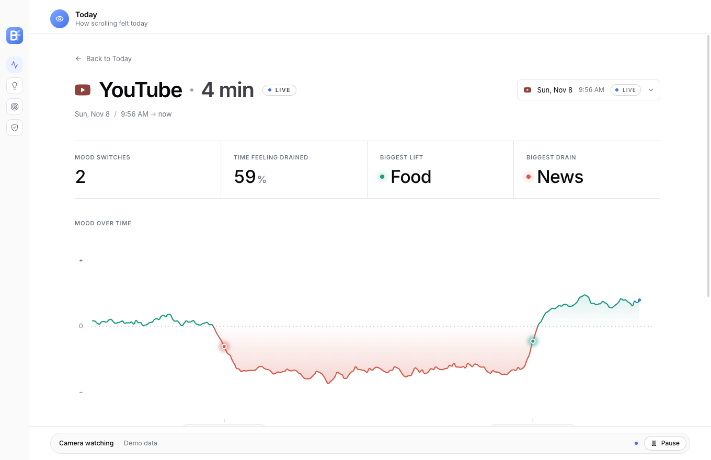
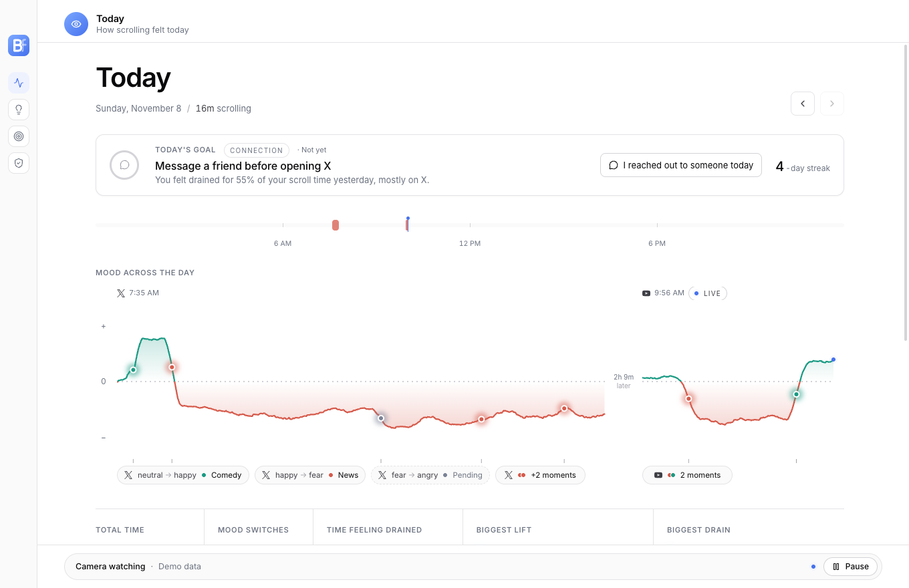
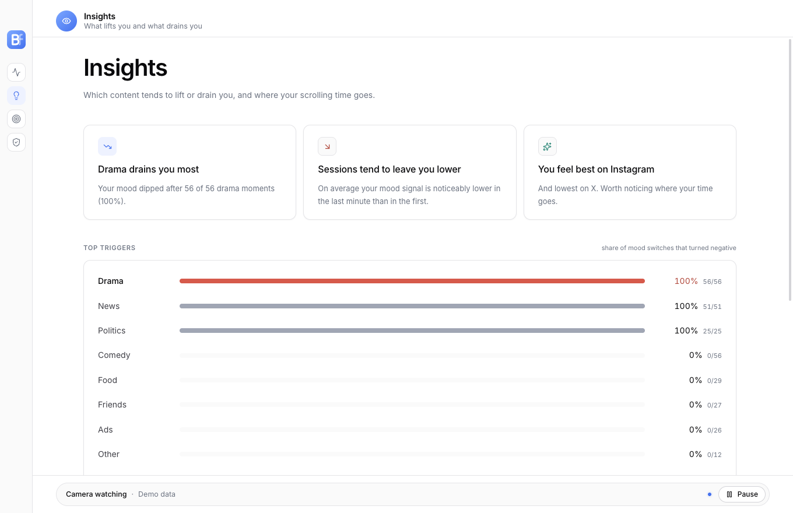
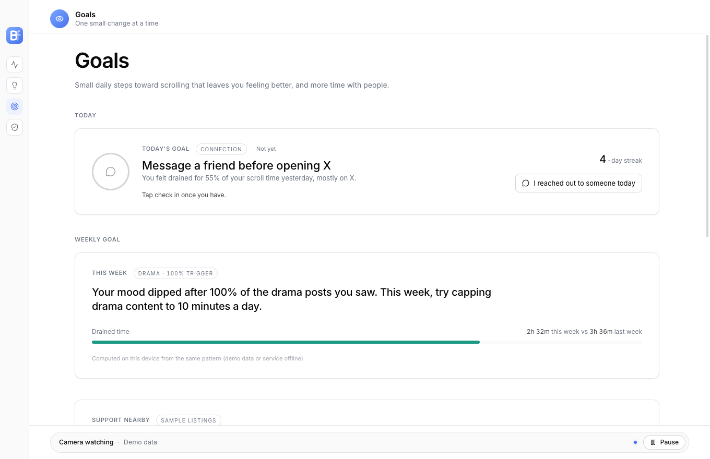
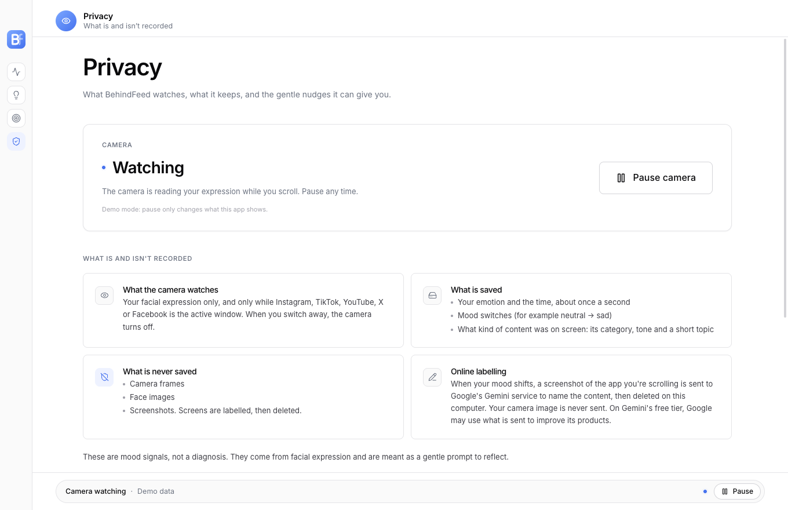

<div align="center">


# BehindFeed

### Know what your scroll is doing to your mood

A desktop app that notices how short-form content changes your mood, and shows you which content lifts you and which drains you.

[](https://github.com/Girish200827/behind-the-feed-hack-the-change-2026/releases/latest)
[](https://github.com/Girish200827/behind-the-feed-hack-the-change-2026/actions/workflows/codeql.yml)
[%20%7C%20Windows%2010%2F11-4672ee)](#download)
[](LICENSE)

**[Download](#download)** · **[Devpost](https://devpost.com/software/behindfeed)** · **[How it works](#how-it-works)** · **[Privacy](#privacy)** · **[Run from source](#run-from-source)** · **[Team](#team)**

Built for **Hack the Change 2026** (Calgary)

</div>

<br />

<p align="center">
  
</p>

## Why BehindFeed

We spend hours a day scrolling, and most of us can't say what it does to how we feel. Screen-time tools tell you *how long* you scrolled; nothing tells you *what it did to you*, or which content caused it.

BehindFeed makes that visible. While you scroll Instagram, TikTok, YouTube, X or Facebook, it reads your facial expression on your own computer. When your mood shifts, it notes what was on screen at that moment. The dashboard then shows, live, which content lifts you and which drains you, and suggests one small goal.

> These are mood signals, not a diagnosis. They're a gentle prompt to reflect.

## Features

| | |
|---|---|
| **Automatic, only while you scroll** | The camera turns on only while a social media site or app is in front, and off as soon as you switch away. |
| **Mood switches with context** | When a new mood holds for two seconds, BehindFeed labels what was on screen: category (news, comedy, drama, friends…), tone and a short topic. |
| **Today and session reports** | A mood line across your day and per session, with every switch tagged by the content behind it. |
| **Insights** | Which content tends to drain you, how you feel on each platform, and whether sessions leave you lower than they started. |
| **Goals** | One small daily goal picked from yesterday's pattern, a weekly goal with progress, and a streak. |
| **Gentle nudges** | After five minutes of draining content, a quiet notification suggests reaching out to someone instead. |
| **Support nearby** | In a heavily draining week, real Calgary and Alberta support services are one click away. |
| **Pause any time** | One click in the status bar turns the camera off within a second. |

<table>
  <tr>
    <td width="50%"></td>
    <td width="50%"></td>
  </tr>
  <tr>
    <td align="center"><b>Today</b>: your mood across every session</td>
    <td align="center"><b>Insights</b>: which content drains or lifts you</td>
  </tr>
  <tr>
    <td width="50%"></td>
    <td width="50%"></td>
  </tr>
  <tr>
    <td align="center"><b>Goals</b>: one small change at a time</td>
    <td align="center"><b>Privacy</b>: what is and isn't recorded, and Pause</td>
  </tr>
</table>

## Download

Get the installer from the website (sign in with Auth0, then download), or straight from the [latest release](https://github.com/Girish200827/behind-the-feed-hack-the-change-2026/releases/latest):

| Platform | Installer |
|---|---|
| **macOS** (Apple Silicon) | [BehindFeed-mac-arm64.dmg](https://github.com/Girish200827/behind-the-feed-hack-the-change-2026/releases/latest/download/BehindFeed-mac-arm64.dmg) |
| **Windows** 10/11 | [BehindFeed-Setup-win-x64.exe](https://github.com/Girish200827/behind-the-feed-hack-the-change-2026/releases/latest/download/BehindFeed-Setup-win-x64.exe) |

Everything is inside: the dashboard, the backend and the camera models. No Python or Node.js needed. Your data stays on your computer (macOS: `~/Library/Application Support/BehindFeed`, Windows: `%APPDATA%\BehindFeed`).

### First start

The app isn't code-signed yet (hackathon build), so your system warns once:

- **macOS:** drag BehindFeed to Applications and open it. When macOS says it "could not verify BehindFeed is free of malware", click **Done**, then open **System Settings → Privacy & Security** and click **Open Anyway**. Or run `xattr -dr com.apple.quarantine /Applications/BehindFeed.app` in Terminal.
- **Windows:** if the browser blocks the download, choose **Keep → Keep anyway**. If SmartScreen says "Windows protected your PC", click **More info → Run anyway**.

Then allow what it asks for:

- **Camera:** reads your expression, only while a social media site is in front.
- **Screen Recording** (macOS): labels what was on screen at a mood switch. Quit and reopen the app after allowing it.
- **Control Safari/Chrome** (macOS): to see which site is open.

If something doesn't work, the app's log is `engine.log` in the data folder above.

## How it works

```
 Social media in front?            Your face, on your computer            At each mood switch
 ┌──────────────────────┐          ┌──────────────────────────────┐        ┌─────────────────────────┐
 │ Detector             │ camera   │ YuNet face detection         │ switch │ Front window, in memory │
 │ (front app / browser │────on───▶│ MediaPipe face landmarks     │───────▶│ → Google Gemini         │
 │  tab, once a second) │          │ HSEmotion emotion + valence  │        │ → category, tone, topic │
 └──────────────────────┘          └──────────────────────────────┘        └─────────────────────────┘
            │                                      │ emotion, ~1/s                      │ label
            ▼                                      ▼                                    ▼
 ┌────────────────────────────────────────────────────────────────────────────────────────────────┐
 │ Backend: FastAPI + SQLite on 127.0.0.1:8000. Scroll sessions, events, insights and goals      │
 └────────────────────────────────────────────────────────────────────────────────────────────────┘
                                                   │ every 2–15 s
                                                   ▼
 ┌────────────────────────────────────────────────────────────────────────────────────────────────┐
 │ Dashboard: Electron + React. Today, Session, Insights, Goals, Privacy (Pause / Resume)         │
 └────────────────────────────────────────────────────────────────────────────────────────────────┘
```

1. **Detect.** The backend checks once a second which app or browser tab is in front. A social media site starts a scroll session; switching away ends it.
2. **Read the expression.** While a session runs, the camera reads your face about once a second, entirely on your device, after a short calibration to your resting face. A mood switch is recorded when a new mood holds for two seconds.
3. **Label the moment.** At each switch, a few frames of the window in front are captured in memory and sent to Gemini, which returns the content's category, tone and topic. The frames are then dropped.
4. **Reflect.** The dashboard joins emotions, switches and labels by time and shows the patterns.

In the installed app, the backend, the camera monitor and the models are packed into one program (`engine/`), which the app starts and stops itself.

## Privacy

- **Never saved:** camera frames, face images, screenshots. Your face is turned into an emotion label and a number in memory.
- **Saved, on your computer only:** your emotion and the time (about once a second), mood switches, and each switch's content category, tone and topic. Text and numbers only.
- **Sent online:** at a mood switch, the social media window in front is sent to Google Gemini for the content label. BehindFeed's own windows are always blacked out. On Gemini's free tier, Google may use what is sent to improve its products.
- **In your control:** the camera runs only while a social site is in front, and Pause turns it off within a second. A first-launch screen explains all of this before anything starts.

## Tech stack

| Part | Built with |
|---|---|
| **Face** | OpenCV, YuNet, MediaPipe Face Landmarker, HSEmotion (ONNX Runtime) |
| **Screen** | Quartz / Win32 window capture, Google Gemini (`google-genai`) |
| **Backend** | Python, FastAPI, Uvicorn, Pydantic, SQLite |
| **Dashboard** | Electron, React, TypeScript, Tailwind CSS, Motion, d3 |
| **Packaging** | PyInstaller, electron-builder, GitHub Actions |
| **Landing page** | Astro, Auth0, AWS Amplify |
| **Security** | CodeQL code scanning |

## Repository layout

```
backend/                 FastAPI + SQLite: detector, event intake, insights, goals    → backend/README.md
computer_vision/face/    webcam → face → emotion → mood switches                     → computer_vision/face/README.md
computer_vision/screen/  screen grab in memory → Gemini → content label              → computer_vision/screen/README.md
frontend/                Electron + React dashboard                                  → frontend/README.md
engine/                  one program for the installed app (backend + camera + models)
landing/                 website: Astro on AWS Amplify, Auth0 login before download
launch.py                runs everything from source, in order, and stops it together
.github/workflows/       release builds (release.yml) and CodeQL scanning (codeql.yml)
```

## Run from source

### Windows

1. **Once:** double-click `setup_app.bat`. It installs the Python libraries (into `%USERPROFILE%\venvs\face`), the models and the dashboard (`npm install`; needs [Node.js](https://nodejs.org) 20+ and Python 3.11–3.13), and asks for a free [Gemini key](https://aistudio.google.com/apikey) for screen labels.
2. **Every time:** double-click `start_app.bat`. One window starts the backend, the camera and the dashboard, and shows their output.
3. Open Instagram (or TikTok, YouTube, X, Facebook) in your browser and scroll. The camera turns on by itself; the dashboard updates every 2 seconds.
4. **Stop:** close the dashboard window, or press Ctrl+C in the launcher window.

`start_demo.bat` runs the same app without a webcam (scripted moods and canned labels), for a demo on any laptop.

### macOS

Same steps with the `.command` files: double-click `setup_app.command` once, then `start_app.command` (or `start_demo.command` without a webcam). If Finder says it cannot open them, run `chmod +x *.command` in Terminal in this folder once, or start them with `bash setup_app.command`. Needs Python 3.10–3.13 (python.org or `brew install python@3.12`) and Node.js (nodejs.org or `brew install node`).

- **Stop:** quit the dashboard with Cmd+Q (closing its window does not quit a Mac app), or Ctrl+C in Terminal.
- **Permissions, first start:** macOS asks to let Terminal use the camera, record the screen (screen labels) and control Chrome or Safari (to see which site is open). Allow all three. After allowing screen recording, quit Terminal and start again. Use Chrome, Safari, Edge, Brave or Arc; other browsers only show the app name, so sessions are not detected.
- **Privacy is the same as on Windows:** only the window in front is captured, and every window of the camera program (the preview) is blacked out, found by its process id. If the window list (Quartz, installed by setup) is missing, nothing is captured at all.

### Launcher options

| Option (`start_app.bat ...` / `start_app.command ...`) | What it does |
|---|---|
| `--no-preview` | Hide the camera window |
| `--no-screen` | No Gemini screen labels |
| `--demo` | No webcam: scripted moods into a demo Instagram session |
| `--check` | Only check that everything is installed |

### Troubleshooting

- Run only one `setup_app.bat` at a time, and wait for "Setup finished" before `start_app.bat`. Two npm installs in the same folder break each other; setup refuses to start twice, and the launcher refuses to start while setup runs.
- "The dashboard's libraries are only half installed": close every other window using the folder (setup, the launcher, VS Code), then run `setup_app.bat` again. It removes the broken `frontend\node_modules`, reinstalls from `package-lock.json` (`npm ci`), and checks that Electron itself downloaded.
- The launcher starts the dashboard with Node.js directly (the same as `npm run dev:api`), so it does not need npm's helper commands.

### Tests

```bash
cd backend && python -m pytest -q tests                 # backend
cd computer_vision/face && python -m pytest -q          # face
cd computer_vision/screen && python -m pytest -q        # screen
cd frontend && npm test                                 # dashboard
```

## Building the installers

Pushing a tag like `v0.1.0` runs [`.github/workflows/release.yml`](.github/workflows/release.yml), which builds the macOS `.dmg` and the Windows `.exe`, self-tests the engine and its models, and attaches both to the GitHub Release. The Gemini key comes from the `GEMINI_API_KEY` repository secret.

To build locally (macOS shown):

```bash
pyinstaller engine/behindfeed-engine.spec --distpath engine/dist --workpath engine/build
cd frontend && npm run dist          # → frontend/dist/BehindFeed-mac-arm64.dmg
```

## Landing page

The website in [`landing/`](landing) is built with Astro and deployed on AWS Amplify (build settings in [`amplify.yml`](amplify.yml), app root `landing`). Downloads sit behind an **Auth0** login: clicking a download button while signed out opens a "Log in to download" modal, Continue goes to Auth0's login page, and after you sign in the installer you picked starts downloading.

- **Run locally:** `cd landing && cp .env.example .env` (fill in the Auth0 Domain and Client ID), then `npm install && npm run dev`.
- **Auth0:** a Single Page Application with the site URL (and `http://localhost:4321`) in Allowed Callback URLs, Allowed Logout URLs and Allowed Web Origins.
- **Amplify:** the same two values as environment variables, `PUBLIC_AUTH0_DOMAIN` and `PUBLIC_AUTH0_CLIENT_ID`.

## Team

| | Role |
|---|---|
| **Raad** | Computer vision: face, emotion and mood switches |
| **Girish** | Computer vision: screen capture and content labels |
| **Allen** | Backend, desktop packaging and release, landing page |
| **Ahmad Cheema** | Frontend: the dashboard |

## License

[MIT](LICENSE)
