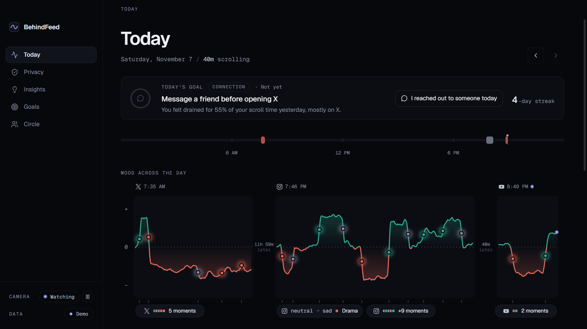

# BehindFeed: Frontend

The desktop dashboard for **BehindFeed**. It shows how scrolling Instagram, TikTok, YouTube, X and Facebook shifted your mood today, which content lifts or drains you, and nudges you toward people instead of feeds.

Built for Hack the Change 2026 (Calgary) on the prompt *"How can we leverage technology to promote health, social connection, and well-being in our communities?"*



## Quick start

You need **Node.js 20+** (tested on Node 24, Windows 11).

```bash
cd frontend
npm install
npm run dev
```

The app window opens on **Today** with two weeks of demo data. On first launch you'll see a short consent screen; tick the box to continue.

> **Window crashes with `Cannot read properties of undefined (reading 'whenReady')`?**
> Your terminal has `ELECTRON_RUN_AS_NODE` set (VS Code does this). Clear it, then run again:
> PowerShell: `Remove-Item Env:ELECTRON_RUN_AS_NODE` · Git Bash: `unset ELECTRON_RUN_AS_NODE`

## Scripts

| Command | What it does |
|---|---|
| `npm run dev` | Run the app with demo data |
| `npm run dev:api` | Run against the backend API at `http://127.0.0.1:8000` (live data) |
| `npm run dev:live` | Demo: only a session in progress |
| `npm run dev:empty` | Demo: no sessions (empty states) |
| `npm run dev:no-samples` | Demo: a session with no mood readings |
| `npm test` | Unit tests (vitest) |
| `npm run build` | Typecheck and production build |

`VITE_DATA_SOURCE=mock|api` picks the data source. `VITE_MOCK_FILE` picks which demo files in `src/mock/` to load (see `.env`).

## What's inside

- **Today**: one day across all platforms: a 24-hour strip, a mood ribbon of every session side by side, moments (what was on screen when your mood switched), a daily summary, a platform breakdown and a sessions list. Click any session for its detail view.
- **Daily social goal**: one small goal a day, picked from yesterday's patterns ("Message a friend before opening X", "No scrolling after 11 PM"...), with a progress ring, a one-tap check-in and a streak.
- **Insights**: which content most often brings your mood down (top triggers), time and mood per platform, and a few plain-language findings.
- **Goals**: the daily goal, the weekly goal, and *Support nearby* (Calgary/Alberta services in the Open Referral format) when the week has been draining.
- **Circle** *(hidden by default; set `VITE_ENABLE_CIRCLE=true` in `.env` to show it)*: share your goal and streak with friends through your own Discord webhook. You see the exact message first.
- **Connect-instead nudges**: after 5+ minutes of draining scrolling, a gentle suggestion to message a friend, step outside or call someone.
- **Privacy**: what is and isn't recorded, a Pause / Resume button, and the nudge setting.

## Privacy, in short

- The camera reads **facial expression only**, and only while a supported app is the active window.
- **Never saved:** camera frames, face images or screenshots.
- **Circle** (when turned on) only sends the message you preview, when you press Share.
- These are **mood signals, not a diagnosis**.

## Project layout

```
frontend/
├─ electron/          Electron main + preload (window, Discord send, notifications)
├─ src/
│  ├─ data/           The only place that touches data: loader, mock/API sources, getDay, goals, circle
│  ├─ mock/           Demo data in the team's event formats (drop the backend's sample file here)
│  ├─ types/          Event types matching the team's contracts
│  ├─ lib/            Pure helpers: smoothing, mood stats, nudges, Circle messages
│  ├─ components/     UI pieces (mood ribbon, cards, sidebar…)
│  └─ pages/          Today, Session, Privacy, Goals, Circle
├─ TESTING.md         How to test, including manual checks
└─ CLAUDE.md          Notes and rules for the AI assistant
```

Stack: Electron, React, TypeScript (electron-vite), Tailwind CSS, d3-shape, motion, Geist fonts.

## Testing

`npm test` runs 38 unit tests: goal selection, streaks, draining-stretch detection, Circle message privacy, and the Discord send path against a local test server. Manual checks (a real Discord message, Windows notifications) are in [TESTING.md](TESTING.md).

## Status

- **Data:** `npm run dev` uses demo data; `npm run dev:api` reads the backend live (start it first, see `backend/README.md`). If the backend is down, the app shows demo data with a "Backend offline" banner.
- **Pause:** only works inside the app until the pause endpoint is agreed with the backend.
- **Support listings:** labelled as samples; check them before relying on them.
